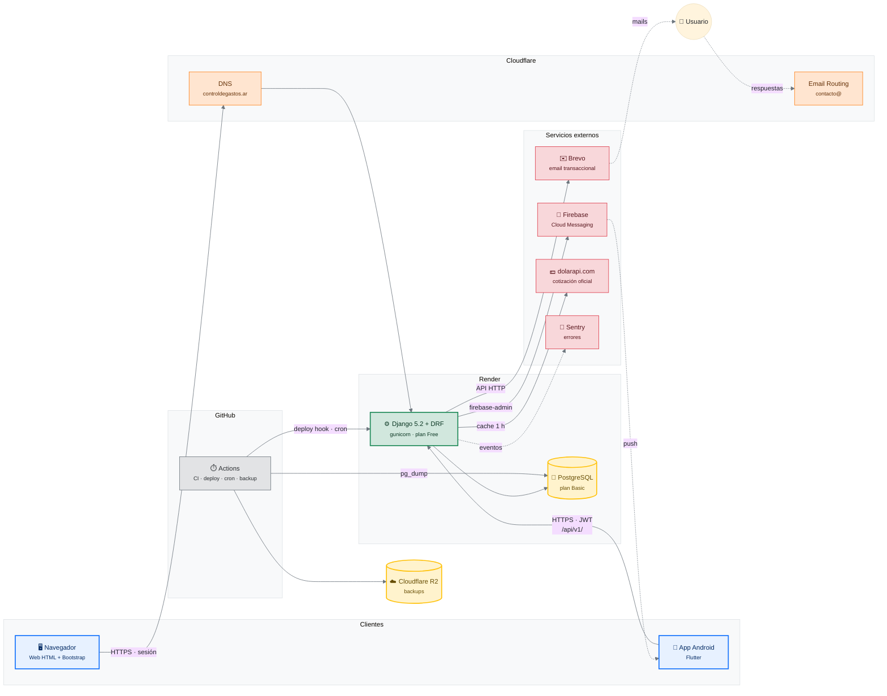
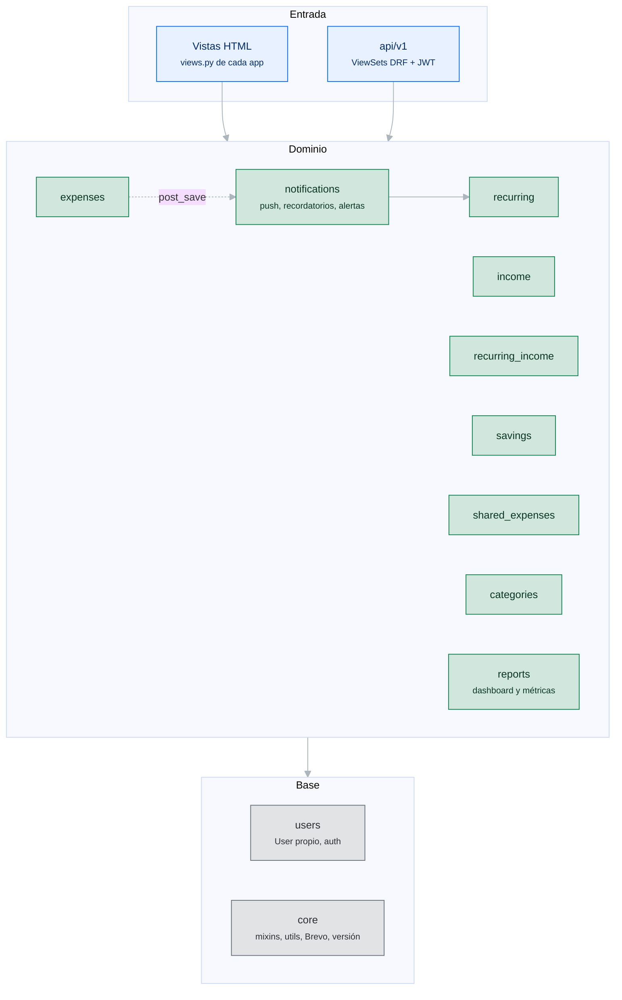
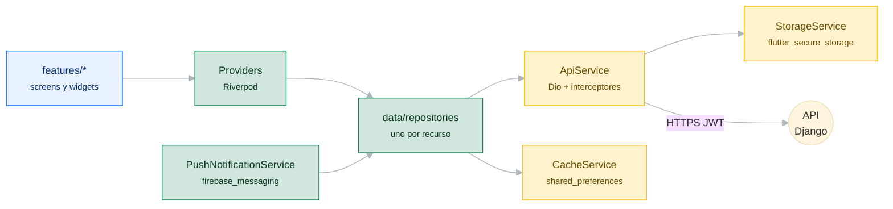
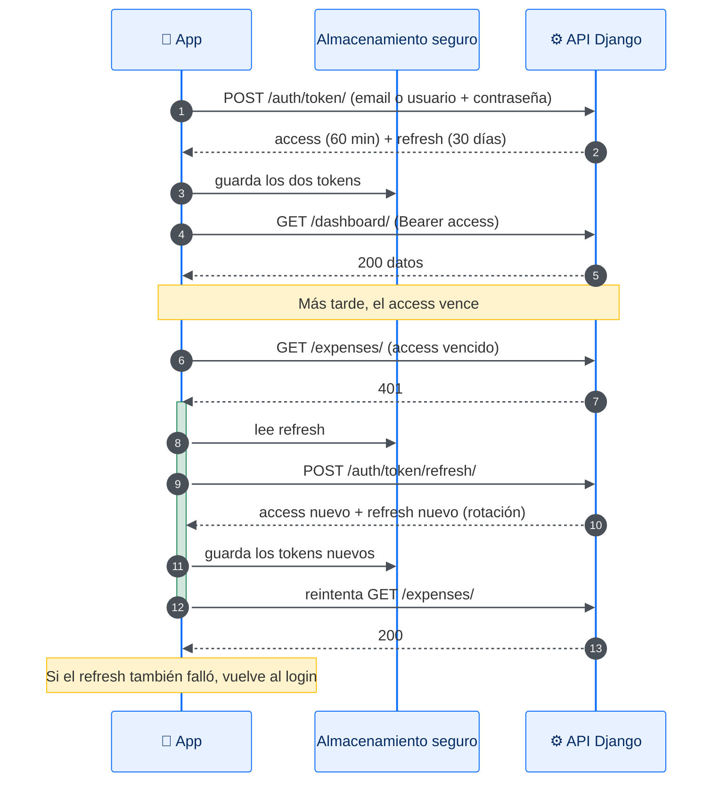
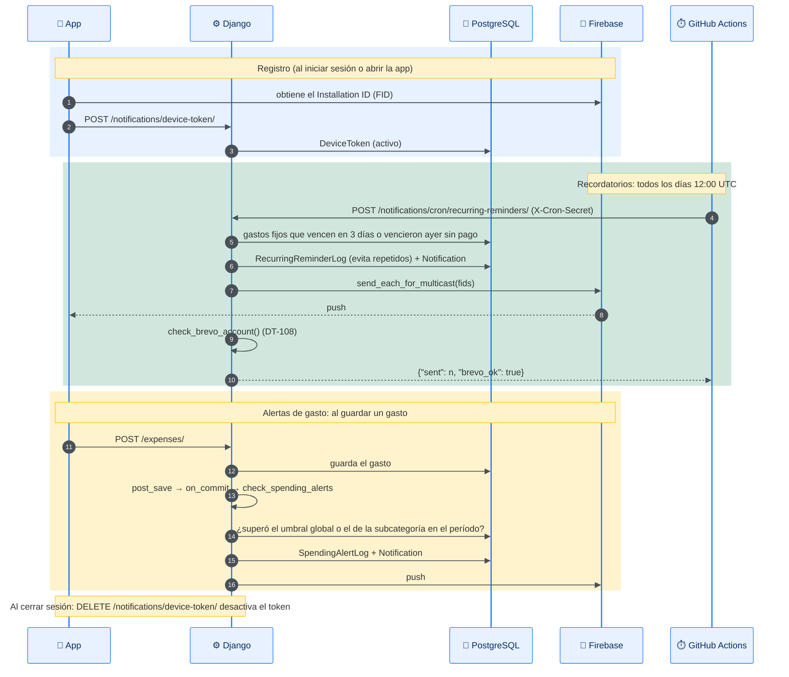
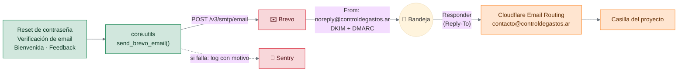
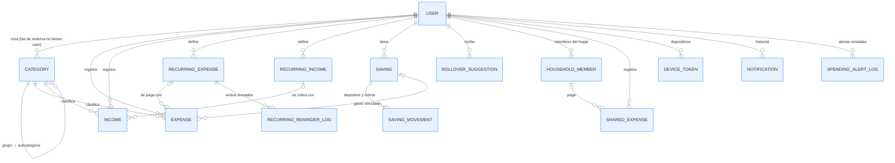
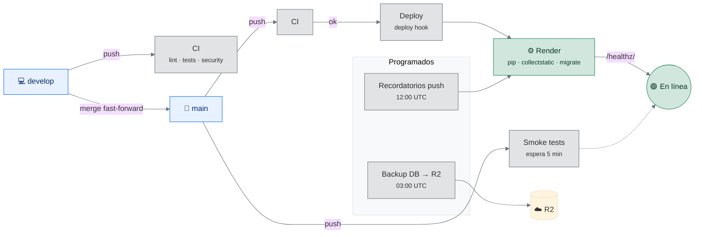

# Arquitectura — Control de Gastos

Cómo está armado el sistema: qué piezas hay, cómo se hablan y dónde corre cada una. El *porqué* de cada decisión está en [`DECISIONS.md`](DECISIONS.md); acá se enlaza la entrada correspondiente.

Última revisión: 2026-11-10 (web 1.29.6, mobile 1.27.2+37).

> **Ver los diagramas:** GitHub los muestra directamente. En VS Code hace falta la extensión *Markdown Preview Mermaid Support*. El diagrama de base de datos está en [`database.dbml`](database.dbml): se pega en [dbdiagram.io](https://dbdiagram.io/d).

---

## Índice

1. [Vista general](#1-vista-general)
2. [Componentes](#2-componentes)
3. [Backend Django](#3-backend-django)
4. [App mobile Flutter](#4-app-mobile-flutter)
5. [Flujos principales](#5-flujos-principales)
6. [Modelo de datos](#6-modelo-de-datos)
7. [CI/CD y tareas programadas](#7-cicd-y-tareas-programadas)
8. [Entornos y configuración](#8-entornos-y-configuración)
9. [Seguridad](#9-seguridad)
10. [Limitaciones conocidas](#10-limitaciones-conocidas)

---

## 1. Vista general

Un único backend Django sirve dos clientes: la **web** (templates HTML con sesión) y la **app Android** (API REST con JWT). Todo corre en Render; los servicios externos se usan por API HTTP.

| Dato | Valor |
|---|---|
| Web | `https://controldegastos.ar` (también `control-gastos-fr8z.onrender.com`) |
| API | `https://control-gastos-fr8z.onrender.com/api/v1/` (la app todavía usa la URL de Render, D-020) |
| Documentación de la API | `/api/v1/docs/` (Swagger, generado por drf-spectacular) |
| Zona horaria | `America/Argentina/Buenos_Aires` (D-012) |

---

## 2. Componentes

| Componente | Tecnología | Dónde corre | Para qué | Referencia |
|---|---|---|---|---|
| Backend | Django 5.2, DRF, SimpleJWT | Render (web service Free) | Web HTML, API REST, reglas de negocio | D-017 |
| Base de datos | PostgreSQL (prod) / SQLite (dev y tests) | Render (Basic) | Persistencia | D-017 |
| App mobile | Flutter, Riverpod, Dio, GoRouter | Android (Google Play) | Cliente nativo de la API | `FLUTTER_ROADMAP.md` |
| DNS | Cloudflare (plan Free, "DNS only") | — | Dominio `controldegastos.ar` | D-020 |
| Email saliente | Brevo (API HTTP, sin SMTP) | — | Reset de contraseña, verificación, bienvenida, feedback | D-013, DT-108 |
| Email entrante | Cloudflare Email Routing | — | `contacto@` reenvía a la casilla del proyecto | D-020 |
| Push | Firebase Cloud Messaging | — | Recordatorios y alertas de gasto | D-019 |
| Cotización | dolarapi.com | — | Dólar oficial para cargar gastos en USD | — |
| Errores | Sentry | — | Excepciones y logs de error en producción | — |
| CI/CD y cron | GitHub Actions | GitHub | Tests, deploy, recordatorios diarios, backups | — |
| Backups | Cloudflare R2 | — | `pg_dump` diario | — |

---

## 3. Backend Django

### Apps

| App | Responsabilidad |
|---|---|
| `core` | Mixins comunes (`TimeStampedModel`, multimoneda con `amount_ars`), envío por Brevo (`send_brevo_email`, `check_brevo_account`), cotización del dólar, `APP_VERSION` y `WHATS_NEW` |
| `users` | Modelo `User` propio, login por email o usuario, verificación de email, reset de contraseña, preferencias |
| `categories` | Categorías de sistema y propias, jerarquía grupo → subcategoría (D-011), ocultar categorías de sistema |
| `expenses`, `income` | Movimientos en ARS o USD; importación de resúmenes de tarjeta (beta) |
| `recurring`, `recurring_income` | Gastos fijos (con cuotas y débito automático) e ingresos fijos |
| `savings` | Metas de ahorro, depósitos y retiros, sugerencia de pasar el sobrante del mes a una meta |
| `shared_expenses` | Gastos del hogar con miembros sin cuenta (D-018) |
| `reports` | Dashboard web, evolución mensual, proyección al cierre |
| `notifications` | Tokens de dispositivo, envío push, recordatorios de vencimiento, alertas por umbral, historial |
| `api` | API REST v1 para la app mobile |
| `budgets` | Sin modelos: el módulo se eliminó (D-007) |

### Convenciones que conviene conocer

- **Multimoneda:** cada movimiento guarda `amount`, `currency`, `exchange_rate` y `amount_ars`. Las métricas siempre suman `amount_ars`, que se calcula en Python al guardar (D-001).
- **Mes financiero:** el usuario elige el día en que arranca su mes (`financial_month_start_day`); los períodos del dashboard y las alertas lo respetan.
- **Fechas:** se usa `timezone.localdate()` y no `now().date()` (D-012).
- **Aislamiento por usuario:** todas las consultas filtran por `request.user`; las vistas usan mixins de `core` para no repetirlo.
- **Caché:** `LocMemCache` en memoria del proceso (cotización del dólar, rate limiting de `/healthz/`). Se pierde en cada reinicio.

---

## 4. App mobile Flutter

| Carpeta | Contenido |
|---|---|
| `lib/features/` | Una carpeta por sección (auth, dashboard, expenses, income, recurring, savings, shared_expenses, categories, notifications, settings, feedback) con sus pantallas, providers y widgets |
| `lib/data/repositories/` | Acceso a la API por recurso |
| `lib/data/services/` | `ApiService` (Dio), `StorageService` (tokens en almacenamiento seguro), `CacheService` (última respuesta en `shared_preferences` para mostrar algo sin conexión), `PushNotificationService` |
| `lib/core/` | Constantes (`api_constants.dart`: URL de la API, links, resumen de la última versión), tema, formateadores de montos, widgets comunes |
| `lib/routing/` | Rutas con GoRouter |

- **URL de la API:** `--dart-define=API_BASE_URL=...`; por defecto, producción. Para el emulador contra el servidor local: `http://10.0.2.2:8001/api/v1`.
- **Versión:** `pubspec.yaml` (`X.Y.Z+N`); el número de build sube en cada subida a Play Console.

---

## 5. Flujos principales

### 5.1 Login y renovación del token (mobile)

Access token de 60 minutos y refresh de 30 días, con rotación. La app renueva sola cuando recibe un 401.

La web usa sesión de Django (cookie de 14 días) con `django-axes`: 5 intentos fallidos bloquean la cuenta.

### 5.2 Notificaciones push

Dos disparadores: el **cron diario** (vencimientos de gastos fijos) y el **guardado de un gasto** (alertas por umbral). Los logs (`RecurringReminderLog`, `SpendingAlertLog`) garantizan un solo aviso por vencimiento o por período.

### 5.3 Email transaccional

Sin SMTP: todo sale por la API HTTP de Brevo. El reset de contraseña de la web pasa por `BrevoPasswordResetForm` (DT-082).

### 5.4 Carga de un gasto en dólares (web)

1. El formulario pide la cotización a `/api/exchange-rate/` (vista de `core`), que consulta dolarapi.com y la guarda en caché una hora.
2. El usuario confirma o corrige la cotización.
3. Al guardar, el modelo calcula `amount_ars = amount × exchange_rate` (D-001).
4. `post_save` dispara las alertas de gasto (5.2).

---

## 6. Modelo de datos

El esquema completo, con tipos, restricciones y notas, está en **[`database.dbml`](database.dbml)**. Para verlo como diagrama, pegar el archivo en [dbdiagram.io](https://dbdiagram.io/d); las tablas aparecen coloreadas por grupo.

Resumen de las relaciones:

---

## 7. CI/CD y tareas programadas

| Workflow | Disparo | Qué hace |
|---|---|---|
| `ci.yml` | push o PR a `develop` / `main` | Ruff (lint y formato), pytest con coverage ≥ 80 %, chequeos de seguridad |
| `deploy.yml` | CI exitoso en `main` | Llama al deploy hook de Render |
| `smoke.yml` | push a `main` | Espera el deploy y prueba endpoints clave |
| `reminders.yml` | diario 12:00 UTC | Recordatorios push + chequeo de la key de Brevo |
| `backup.yml` | diario 03:00 UTC | `pg_dump` de producción a Cloudflare R2 |

Flujo de ramas: se trabaja en `develop` y se pasa a `main` con fast-forward. El build de la app mobile se hace a mano y se sube a Play Console.

---

## 8. Entornos y configuración

| | Desarrollo | Tests | Producción |
|---|---|---|---|
| Settings | `config.settings.dev` | `config.settings.dev` | `config.settings.prod` |
| Base de datos | SQLite | SQLite | PostgreSQL (Render) |
| Email | Brevo si hay `BREVO_API_KEY`; si no, consola | Brevo mockeado; el fallback va a `mailoutbox` | Brevo |
| Push | Sin `FIREBASE_CREDENTIALS_PATH`: no envía | Firebase mockeado | Firebase (service account) |
| Servidor | `runserver` (puerto 8001 para el emulador) | — | gunicorn, 2 workers |

Las variables de entorno están documentadas en [`.env.example`](../.env.example). En producción se cargan en Render; al cambiarlas hay que redeployar.

**Diferencias SQLite / PostgreSQL:** las funciones de fecha y las agregaciones no se comportan igual. Toda lógica que agrupa por día, mes o período tiene tests, pero los tests corren en SQLite.

---

## 9. Seguridad

| Capa | Medida | Referencia |
|---|---|---|
| Login web | `django-axes`: 5 intentos fallidos bloquean | — |
| API | JWT con rotación de refresh; throttling de DRF | — |
| Cabeceras | CSP sin `unsafe-inline` en scripts; scripts de CDN con versión fija y SRI | D-009 |
| `/healthz/` | Rate limiting por IP en memoria | D-004, D-005 |
| Cron | Endpoint protegido con `X-Cron-Secret` (comparación en tiempo constante) | D-019 |
| Datos | Cada consulta filtra por el usuario logueado | — |
| Secretos | Solo en variables de entorno de Render y secrets de GitHub | — |

Auditoría completa en [`AUDITORIA_SEGURIDAD.md`](AUDITORIA_SEGURIDAD.md).

---

## 10. Limitaciones conocidas

| Limitación | Impacto | Referencia |
|---|---|---|
| Render Free apaga el servicio tras 15 min sin tráfico | El primer pedido tarda en despertarlo | DT-106 |
| Caché en memoria del proceso | Con 2 workers cada uno tiene su caché; se pierde al reiniciar | — |
| La app mobile usa la URL de Render para la API | Cambiar de hosting obliga a publicar una versión nueva | D-020 |
| Brevo agrega "Darse de baja" a los mails transaccionales | Si un usuario lo toca, deja de recibir el reset de contraseña | — |
| Interfaz solo en español | Barrera para usuarios fuera de Argentina | DT-105 |
